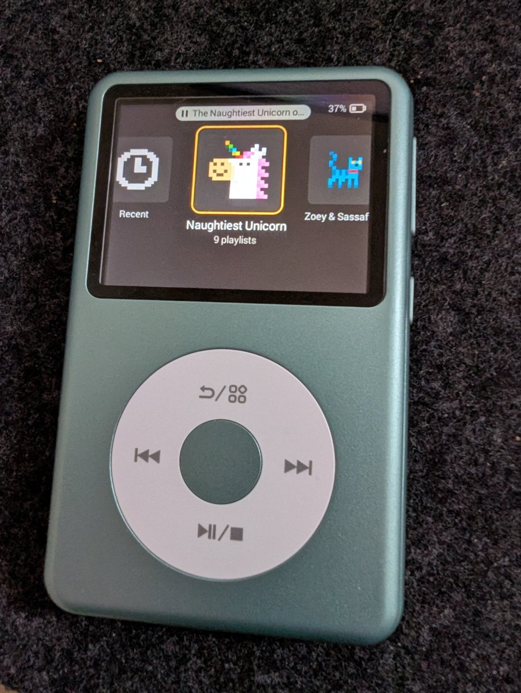
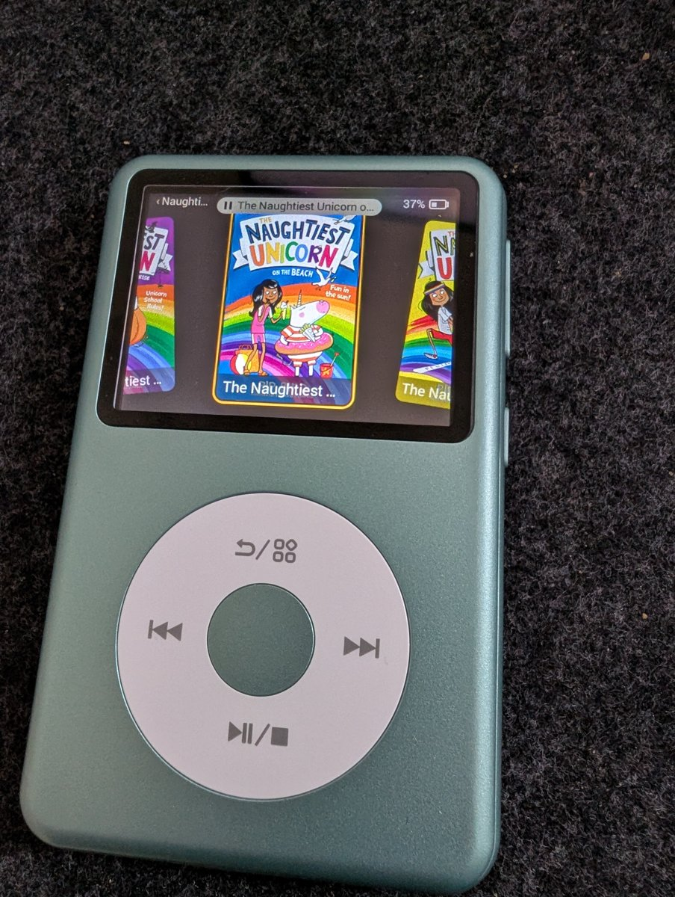
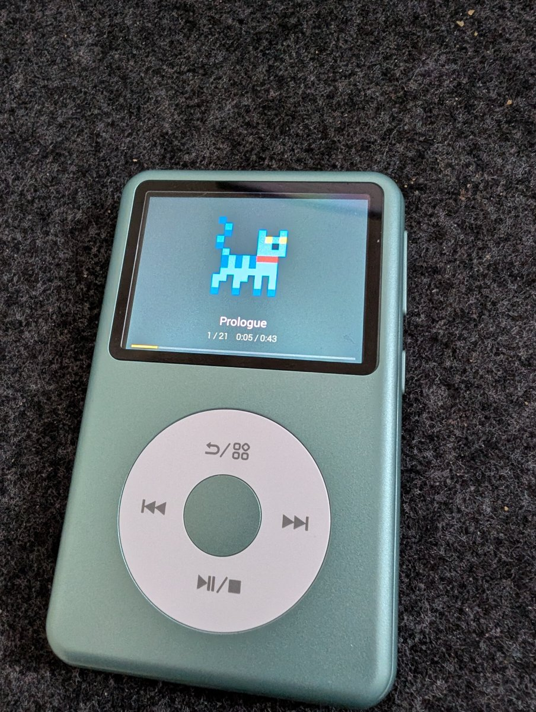

# Studio Pocket

Studio Pocket turns an Innioasis Y2 into a simple, offline audio player for children. It replaces the
Y2's home screen with a player that shows playlists as large covers, plays MP3 and AAC audio,
remembers where each playlist was left, and never needs a network. You load it with audio from a
computer over the USB cable.

<p>
  
  
  
</p>

This repository holds everything needed to do that yourself:

| Folder | What it is |
|---|---|
| `apps/player/` | The player: an Android 4.4 (API 19) app, written in Kotlin, that becomes the Y2's home screen |
| `packages/firmware-tools/` | The installer engine and the `studio-pocket-firmware` command: reads the player's own system partition, patches the player in, writes it back and verifies it, and restores the original |
| `packages/library-format/` | The folder layout and file formats the player reads from its storage |
| `packages/sync-engine/` | Copies playlists onto the player safely, and the `studio-pocket-sync` command |
| `firmware/` | Patch recipes and notes (no firmware: none is ever committed here) |
| `scripts/` | Build scripts for the player and for the two tools the installer runs (mtkclient and e2fsprogs) |
| `docs/` | How it works, what has been tested on hardware, recovery and licensing |

Start with [docs/architecture/overview.md](docs/architecture/overview.md) for how the parts fit
together.

**Status.** Install, restore, playback and loading a library have been run end to end on a real Y2
from a Mac, with the commands below. The installer knows three stock firmware builds: 3.2.1,
3.2.0 with the FM Radio app (the one tested on hardware so far), and 3.2.4. It refuses any other. What has
and has not been run on a player: [docs/tested-hardware.md](docs/tested-hardware.md). Treat this as
a project for people comfortable with a terminal.

## What you need

- A computer running macOS or Linux. (Every hardware run so far was from macOS.)
- Node 22 and pnpm.
- To build the player: the Android SDK and a JDK. Android Studio provides both.
- To build e2fsprogs: a C toolchain. On macOS, the Xcode command line tools
  (`xcode-select --install`); on Linux, your distribution's build tools (for example
  `build-essential`).
- To build mtkclient: Python 3.12.
- An Innioasis Y2 and a USB **data** cable (charge-only cables are the most common reason a player
  is not found).

## Build

```bash
pnpm install
pnpm -r build
pnpm -r test      # some firmware-tools tests need e2fsprogs (below)
```

The player. `make-dev-keystore.sh` creates a development signing key once (it stays on your
machine and is ignored by git); keep it, because every later build you install on the same player
must be signed with the same key.

```bash
scripts/make-dev-keystore.sh
scripts/build-player.sh                          # unit tests, lint, signed APK: build/player/StudioPocket.apk
```

`build-player.sh` looks for Android Studio's JDK and SDK in their usual macOS places. On Linux, set
`JAVA_HOME` and `ANDROID_HOME` first.

The tools the installer runs. Both are separate programs; nothing from them is built into this
code.

```bash
scripts/setup-mtkclient-venv.sh                  # mtkclient at a pinned commit, with the Studio Pocket patches
scripts/build-e2fsprogs.sh                       # debugfs, e2fsck, dumpe2fs 1.47.4 from a hash-checked tarball
```

The build scripts write to `build/player/`, `build/e2fsprogs/<os>/` and `build/mtkclient/`; set
`OUT_DIR` to put the output somewhere else, and then point `STUDIO_POCKET_E2FS_DIR` at the e2fsprogs
folder.

`studio-pocket-firmware` finds the mtkclient set up by the first command, and the e2fsprogs in
`build/e2fsprogs/<os>/`, by itself. Instead of building e2fsprogs you can install your system's copy
(`apt install e2fsprogs`, or `brew install e2fsprogs` on macOS); it is used when neither
`STUDIO_POCKET_E2FS_DIR` nor `build/e2fsprogs/<os>/` has the tools.

## Using a release

Each release on GitHub carries a signed player APK (`StudioPocket-<version>.apk`), ready-built tools
(`e2fsprogs-macos-universal.tar.gz`, `e2fsprogs-linux-x64.tar.gz`, `mtkclient-macos-arm64.tar.gz`)
and `SHA256SUMS`. You still need this repository, built as above (`pnpm install`, `pnpm -r build`),
for the `studio-pocket-firmware` and `studio-pocket-sync` commands; the release replaces building the player and
the tools.

Download the APK and the archives for your computer from the release page into one folder, with
`SHA256SUMS`, and check them there:

```bash
shasum -a 256 -c --ignore-missing SHA256SUMS     # Linux: sha256sum -c --ignore-missing SHA256SUMS
```

Unpack the tools and tell `studio-pocket-firmware` where they are (macOS shown; on Linux unpack
`e2fsprogs-linux-x64.tar.gz`, and set up mtkclient with `scripts/setup-mtkclient-venv.sh` instead,
because there is no Linux mtkclient archive):

```bash
mkdir -p ~/studio-pocket-tools/e2fsprogs ~/studio-pocket-tools/mtkclient
tar -xzf e2fsprogs-macos-universal.tar.gz -C ~/studio-pocket-tools/e2fsprogs
tar -xzf mtkclient-macos-arm64.tar.gz -C ~/studio-pocket-tools/mtkclient
export STUDIO_POCKET_E2FS_DIR=~/studio-pocket-tools/e2fsprogs
export STUDIO_POCKET_MTK_BIN=~/studio-pocket-tools/mtkclient/mtk
```

Then use the commands below as they are, with `--apk` naming the downloaded
`StudioPocket-<version>.apk`. Each archive's `licences/` folder and `BUNDLE-INFO.json` say what it
contains; the release also carries the corresponding source of the GPL and LGPL code in them.

### Verifying an official player APK

Every official release signs the player with one key. Its certificate's SHA-256 digest is committed as `release/signing-certificate.sha256`:

```
c1a8d7e7f71a3fc07e2fb830c79338aa927ca2092ca9305734db5b60fa0de8fe
```

Check a downloaded APK against it with `scripts/check-apk-signer.sh StudioPocket-<version>.apk` (needs the Android build-tools' `apksigner`, `ANDROID_HOME` set), or by hand with `apksigner verify --print-certs` and comparing the signer's SHA-256 digest. An APK whose digest differs was not built by the release workflow; do not install it.

## Install Studio Pocket on a Y2

The installer never downloads firmware. It reads your player's own system partition, keeps that
copy as the player's restore image, swaps the stock home screen for the Studio Pocket player, and
writes the result back. Only the system partition is ever written; the parts that start the
device are never touched, which is what keeps a player recoverable. Every write asks you to type
`WRITE`, and is checked by reading the player back.

Pick a folder on your computer to hold the player's files (the "firmware dir"). Keep it: it holds
the only copy of your player's original software.

```bash
alias studio-pocket-firmware="node $PWD/packages/firmware-tools/dist/cli.js"
studio-pocket-firmware read-device --firmware-dir ~/studio-pocket-work/y2
```

Power the player off and connect the cable before you start. When the command says it is waiting,
press the reset pinhole on the player (between the power button and the headphone jack, with a
paper clip). The player restarts and the read begins; it takes about six minutes. It ends with
`MATCH: the player carries …` when it knows your firmware. Then:

```bash
studio-pocket-firmware prepare-device --firmware-dir ~/studio-pocket-work/y2 --apk build/player/StudioPocket.apk
studio-pocket-firmware write --firmware-dir ~/studio-pocket-work/y2 --action install
```

`prepare-device` builds and checks the patched image on your computer; nothing is written to the
player. `write` prints a checklist and asks you to type `WRITE`; press the pinhole again when it
waits, and do not unplug during the write (about four minutes). It finishes with
`WRITE VERIFIED`. Unplug the player and switch it on: it starts Studio Pocket.

Each player gets its own folder under `units/` in the firmware dir, named by its storage chip's
id. Before every write the installer reads a little of the connected player to check it is the
player the image belongs to, and stops with nothing written if it is not.

### The first flash downloads one file

mtkclient talks to the player through MediaTek's download agent: a small program it loads into the
player's memory to read and write its storage. It is MediaTek's, and this project does not
distribute it: no release file and no tools archive contains it. The first time you read or write
a player, the installer downloads the one file the Y2 needs, `MTK_AllInOne_DA_mt6590.bin`, from
upstream mtkclient's repository at the commit the tools are built from (`7cb40e7`), and checks it
against the SHA-256 committed in `packages/firmware-tools/src/da-pin.json`. A file with any other
hash is deleted and the command stops. The checked file is kept in the firmware dir, under
`tools/da/`, and is checked again before every session, so nothing is downloaded after the first
time. `studio-pocket-firmware mtk-check --firmware-dir <dir>` fetches it on its own and prints where
it is.

Offline, or if the download is blocked: get the file yourself (it is in upstream mtkclient's
`mtkclient/Loader/` folder at that commit) and set `STUDIO_POCKET_DA_FILE` to its path. It must
have the same SHA-256; `STUDIO_POCKET_DA_FILE_UNCHECKED=1` uses it anyway and says so. No OEM
preloader is needed for the Y2 and none is distributed; if a player ever asks for one, the
installer stops before anything is written and names `STUDIO_POCKET_PRELOADER_FILE`.

### Upgrade a player that already runs Studio Pocket

```bash
studio-pocket-firmware read-device --firmware-dir ~/studio-pocket-work/y2
studio-pocket-firmware prepare-upgrade --firmware-dir ~/studio-pocket-work/y2 --apk build/player/StudioPocket.apk
studio-pocket-firmware write --firmware-dir ~/studio-pocket-work/y2 --action upgrade
```

`read-device` recognises an installed player and keeps the read for the upgrade; `prepare-upgrade`
swaps in the new APK and checks the image. The upgrade has not yet been run on a real player (see
[docs/tested-hardware.md](docs/tested-hardware.md)). The new APK must be signed by the same key as the one
already on the player, or `prepare-upgrade` refuses it. `--allow-new-signer` overrides that check
for a player that was set up with a different key, but the safer route is the one below: restore
to stock, then install.

### Restore to stock

```bash
studio-pocket-firmware write --firmware-dir ~/studio-pocket-work/y2 --action restore
```

This writes back the copy `read-device` kept. It only works from the firmware dir that read the
player before it was installed: once Studio Pocket is on the player, its original home screen is no
longer on the device. More, including what to do if a player does not start:
[docs/recovery/y2-recovery.md](docs/recovery/y2-recovery.md).

### Players running a build you made yourself

A player can only be upgraded with an APK signed by the same key as the one already on it. If your
player runs a Studio Pocket you built and signed with your development key, restore it to stock
(above) before you install an official release on it for the first time.

## Load audio with `studio-pocket-sync`

Put each playlist in its own folder, with the audio files directly inside it:

```
Bedtime/
  Stories/
    01 The Owl.mp3
    02 The Fox.mp3
  Songs/
    Lullaby.m4a
```

Connect the player with the cable. It shows "Connected to computer" and its storage appears on the
computer (if the player asks, confirm USB storage on its screen). Find where the computer mounts
it, for example `/Volumes/NO NAME` on a Mac. Then:

```bash
alias studio-pocket-sync="node $PWD/packages/sync-engine/dist/folder-cli.js"
studio-pocket-sync ~/Music/Bedtime "/Volumes/NO NAME" --create
```

`--create` is needed the first time only, to mark the player's storage as a Studio Pocket library.
Eject the volume and unplug: the player picks up the new playlists by itself.

- Each folder becomes a playlist named after the folder; tracks play in file-name order.
- MP3, M4A and AAC files are accepted. The player runs Android 4.4, which cannot play Opus, FLAC or
  WAV, so convert those first.
- Images, text files, playlist files and `.json` files (`.jpg`, `.txt`, `.m3u` and so on) are
  ignored and listed.
- The command refuses, and writes **nothing**, if any file would not play: audio of another type,
  a file it cannot read as audio, audio loose at the top level instead of in a playlist folder, or
  audio in a folder inside a playlist folder. It lists every problem, so you can fix them all at
  once.
- It refuses places that are never a player (your home folder, the root of the file system) and a
  volume with no Studio Pocket library unless you pass `--create`.
- Running it again copies only what changed. It never removes a playlist from the player.
- If the copy is interrupted (cable pulled, computer asleep), run the command again: it finishes
  the job. New and changed files are copied under temporary `.part` names first, so an
  interruption during the copy leaves every playlist already on the player playable in its previous
  version, and new playlists do not show yet. Only an interruption in the short switch-over at the
  end (a few renames per playlist, then the playlist list) can leave a playlist that was being
  replaced hidden on the player until the next complete run.

MYO Studio downloads work as they are: point the command at the download folder, or at a folder of
them; titles, track icons and the cover come across. Unzip a download first (zip files are not
opened). Opus downloads cannot be played; use the AAC version.

```bash
studio-pocket-sync ~/Downloads/Christmas-Songs-full "/Volumes/NO NAME"
studio-pocket-sync ~/Downloads/MYO "/Volumes/NO NAME"     # a folder of downloads (and playlist folders)
```

The on-player format is described in
[docs/architecture/library-format.md](docs/architecture/library-format.md).

## Documentation

- [docs/architecture/overview.md](docs/architecture/overview.md): how the parts fit together
- [docs/development/flashing-macos.md](docs/development/flashing-macos.md): how and why the player
  is written with mtkclient, and the mtkclient patches
- [docs/tested-hardware.md](docs/tested-hardware.md): what has been run on a real player, and what
  has not
- [docs/recovery/y2-recovery.md](docs/recovery/y2-recovery.md): getting a player back to stock
- [docs/licensing/third-party.md](docs/licensing/third-party.md): third-party code and binaries,
  and what may not be redistributed

Stock Innioasis firmware is never committed to this repository and never downloaded by these tools.

## Licence

Studio Pocket is free software under the GNU General Public License, version 3 only: see
[LICENSE](LICENSE). The copyright holder, Ashworth Digital Ltd, also offers it under a commercial
licence for uses GPL-3.0 does not allow: see [COPYING.commercial](COPYING.commercial).
Contributions need a signed contributor licence agreement: see [CONTRIBUTING.md](CONTRIBUTING.md).
Security problems: [SECURITY.md](SECURITY.md).

The names "Studio Pocket" and "MYO Studio", and their logos, are not licensed under GPL-3.0. If you
publish a modified version, give it another name.

Studio Pocket is not made or endorsed by Innioasis.
